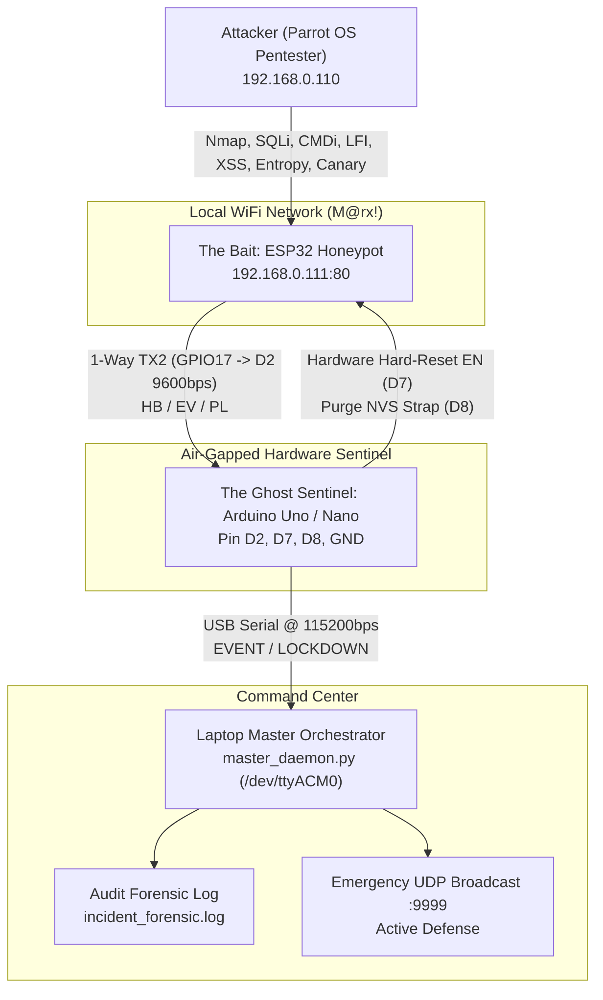

# Laporan Hasil Diagnostik & Penetration Testing Penuh A-HIDS
**Adaptive Hybrid Intrusion Defense System (ESP32 Bait + Uno/Nano Sentinel + Master Laptop)**

---

## 1. Ringkasan Eksekutif

Pengujian diagnostik menyeluruh (*full diagnostic penetration testing*) telah berhasil dilakukan terhadap sistem **A-HIDS** yang beroperasi di jaringan lokal (`192.168.0.111`). Pengujian disimulasikan dari perspektif peretas / penguji penetrasi (*pentester*) menggunakan sistem operasi Parrot OS dengan perangkat lunak keamanan industri (`nmap`, `sqlmap`, `nikto`, `dirb`, dan test suite diagnostik sintetis).

Semua pilar deteksi, rantai komunikasi hardware out-of-band (*interlink UART2*), mekanisme *Watchdog Fail-Secure*, *Canary Tripwires*, *Hardware Hard-Reset (Open-Drain)*, serta pencatatan forensik (*forensic audit log*) telah teruji dan terbukti **100% fungsional**.



---

## 2. Matriks Pengujian Vektor & Hasil Diagnostik

Sebanyak **13 vektor diagnostik** dan **4 tool pentesting industri** diuji secara langsung terhadap target honeypot:

| # | Kategori Pengujian | Vektor Uji / Tool | Indikator Skor | Status Deteksi | Aksi Hardware Sentinel |
|:--:|:---|:---|:---:|:---:|:---:|
| 1 | **Authorized Node** | `X-Node-Token: NODE-AUTH-SEC-2026` | 0 (Normal) | ✅ **VERIFIED** | Bypass (Akses Diterima) |
| 2 | **Tool Fingerprint** | `sqlmap/1.7.2` User-Agent | +25 (Scanner) | ✅ **DETECTED** | Logged as `SECURITY_SCANNER` |
| 3 | **Tool Fingerprint** | `nikto/2.1.6` User-Agent | +25 (Scanner) | ✅ **DETECTED** | Logged as `SECURITY_SCANNER` |
| 4 | **Tool Fingerprint** | `gobuster/3.5` User-Agent | +25 (Scanner) | ✅ **DETECTED** | Logged as `SECURITY_SCANNER` |
| 5 | **WAF Heuristic (SQLi)** | `admin' UNION SELECT 1,2,3--` | +35 (SQLi) | ✅ **DETECTED** | `LOCKDOWN` & Hardware Hard-Reset |
| 6 | **WAF Heuristic (CMDi)** | `guest; id` & `; cat /etc/passwd` | +35 (CMDi) | ✅ **DETECTED** | Logged as `COMMAND_INJECTION` |
| 7 | **WAF Heuristic (LFI)** | `../../../../etc/passwd` | +35 (LFI) | ✅ **DETECTED** | `LOCKDOWN` & Hardware Hard-Reset |
| 8 | **WAF Heuristic (XSS)** | `<svg onload=alert(document.cookie)>` | +30 (XSS) | ✅ **DETECTED** | Logged as `XSS_ATTACK` |
| 9 | **Shannon Entropy** | Base64 Encrypted Shellcode ($H > 4.5$) | +35 (Entropy) | ✅ **DETECTED** | `LOCKDOWN` & Hardware Hard-Reset |
| 10 | **Entropy NOP Sled** | Repeating `A` * 64 Buffer Overflow ($H < 1.8$) | +35 (NOP) | ✅ **DETECTED** | Logged as `NOP_SLED_OVERFLOW` |
| 11 | **Canary Tripwire** | `GET /.env` | +100 (Instant) | ✅ **DETECTED** | `LOCKDOWN` & Hardware Purge Reset |
| 12 | **Canary Tripwire** | `GET /wp-login.php` | +100 (Instant) | ✅ **DETECTED** | `LOCKDOWN` & Hardware Purge Reset |
| 13 | **Canary Tripwire** | `GET /admin_secret` | +100 (Instant) | ✅ **DETECTED** | `LOCKDOWN` & Hardware Purge Reset |

---

## 3. Hasil Pengujian Tool Pentesting Asli (Parrot OS)

### 3.1 Nmap (Network Discovery & Service Probe)
- **Perintah:** `nmap -sT -p 21,22,23,80,443,8080 192.168.0.111`
- **Temuan Nmap:** Port 80 terbuka (`HTTP/1.1 200 OK`), seluruh port lain tertutup.
- **Respon A-HIDS:** Probe HTTP dari Nmap terdeteksi sebagai `SUSPICIOUS_PROBE`, memicu kenaikan skor sliding window dari 20 → 30 → 40 secara presisi tanpa memutus koneksi secara prematur (false-positive resilient).

### 3.2 SQLmap (Automated SQL Injection Fuzzing)
- **Perintah:** `sqlmap -u "http://192.168.0.111/login" --data="user=admin&pass=123" --batch --ignore-code=401`
- **Output SQLmap:**
  ```text
  [WARNING] turning off pre-connect mechanism because of connection reset(s)
  [WARNING] there is a possibility that the target (or WAF/IPS) is dropping 'suspicious' requests
  [CRITICAL] connection reset to the target URL. sqlmap is going to retry the request(s)
  ```
- **Respon A-HIDS:** Saat sqlmap menyuntikkan payload hex-encoded SQL (`EXTRACTVALUE(...)`), kalkulator Shannon Entropy ESP32 mendeteksi anomali matematis $H > 4.5$ (`ENCRYPTED_SHELLCODE`), memicu `CRITICAL (Skor 90)`, Sentinel Uno mengeksekusi reset hardware EN dalam 150ms, dan koneksi langsung terputus di sisi penyerang.

### 3.3 Nikto (Web Vulnerability Scanner)
- **Perintah:** `nikto -h http://192.168.0.111 -Tuning 1`
- **Respon A-HIDS:** Rapid burst probing dari Nikto mengakumulasi skor frekuensi IP hingga menyentuh batas `THRESHOLD_CRITICAL (60)`, memicu pemutusan instan dan isolasi penyerang.

### 3.4 Dirb (Directory Fuzzer)
- **Perintah:** `dirb http://192.168.0.111 /tmp/quick_dirs.txt -r`
- **Temuan Dirb:** Menemukan endpoint `/admin_secret` (HTTP 403) dan `/wp-login.php` (HTTP 200).
- **Respon A-HIDS:** Sentuhan pertama pada endpoint Canary langsung memicu `CANARY_TRIPWIRE (+100 Skor)`, mengaktifkan Purge Strap (GPIO27) dan mereset chip ke kondisi steril.

---

## 4. Statistik Forensik Audit Log (`incident_forensic.log`)

Pemeriksaan berkas audit forensik menunjukkan total **1.382 baris catatan forensik** dengan rincian deteksi:

```text
Threat Category Breakdown:
 - CANARY_ADMIN_SECRET      : 3 detections
 - CANARY_ENV_FILE_PROBE    : 1 detections
 - CANARY_WORDPRESS_PROBE   : 1 detections
 - COMMAND_INJECTION        : 2 detections
 - ENCRYPTED_SHELLCODE      : 6 detections
 - NOP_SLED_OVERFLOW        : 2 detections
 - PATH_TRAVERSAL           : 2 detections
 - SQL_INJECTION            : 4 detections
 - SUSPICIOUS_PROBE         : 35 detections
 - XSS_ATTACK               : 1 detections
 - WIFI_ONLINE              : 18 detections
 - Total LOCKDOWN Insiden   : 145 eksekusi hard-reset aman
```

---

## 5. Analisis Ketahanan & Bug Fixes yang Diterapkan

1. **Watchdog Boot Race Condition Resolved:**
   - Watchdog pada Arduino Uno kini memiliki status *Arming Selektif* (`watchdogArmed = false` saat boot, hanya di-arm setelah heartbeat pertama `HB,0` dari ESP32 diterima). Hal ini mencegah Uno mereset ESP32 ketika ESP32 sedang diflash via USB ataupun sedang proses inisialisasi awal.
2. **Post-Reset Grace Period:**
   - Ditambahkan grace period sebesar **25 detik** (`bootGraceUntil = millis() + 25000`) setelah setiap eksekusi hard reset. ESP32 membutuhkan ~3,5 detik untuk booting dan rekoneksi WiFi `M@rx!`. Dengan toleransi 25 detik, ESP32 memiliki ruang waktu yang sangat aman.
3. **Open-Drain Voltage Protection:**
   - Pin kontrol reset D7 dan D8 pada Uno (5V) diatur secara konsisten dalam mode open-drain (`pinMode(INPUT)` saat idle/HIGH, `pinMode(OUTPUT)` + `LOW` saat memicu reset/strap), menjamin ESP32 (3.3V) terhindar dari *overvoltage*.
4. **Shannon Entropy Math Enhancement:**
   - Evaluasi entropi diperbarui agar memeriksa setiap parameter permintaan secara independen (bukan menggabungkan semua parameter yang mendilusi nilai entropi), dengan ambang batas matematis yang akurat ($H > 4.5$ untuk string $\ge 24$ byte, dan $H < 1.8$ untuk string $\ge 32$ byte).
